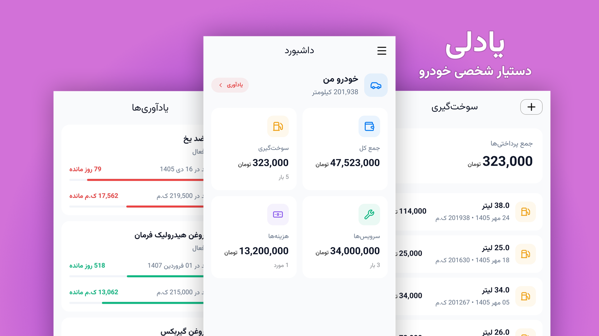
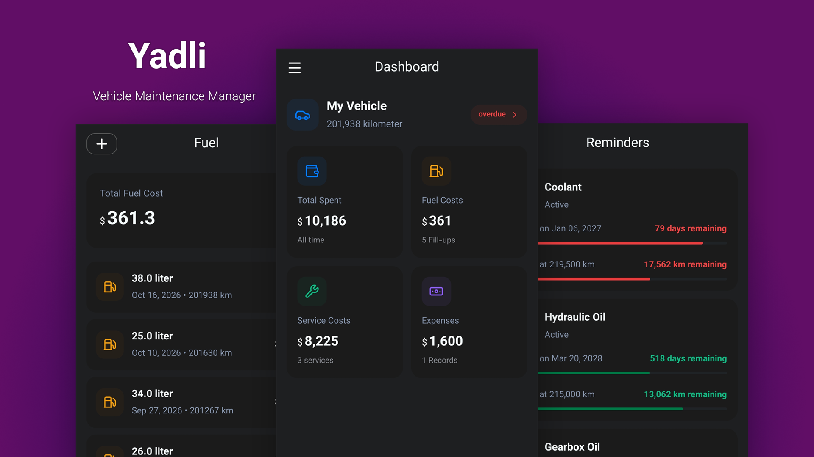

<details open>
  <summary>فارسی</summary>

  <div dir="rtl">

# یادلی - دستیار شخصی خودرو

«یادلی» یک دستیار شخصی خودرو است که امکان ثبت سوابق سوخت‌گیری، سرویس‌های دوره‌ای و انواع هزینه‌های متفرقه را می‌دهد، همچنین برنامه امکان یادآوری سرویس‌های دوره‌ای برای جلوگیری از هزینه‌های سنگین تعمیر خودرو، دارد. یادلی اپلیکیشن اندرویدی، کاملا رایگان، آفلاین و بدون نیاز به اینترنت و بدون نیاز به ثبت نام و حق اشتراک است. تمامی داده‌های خودروهای شما بر روی گوشی خود شما ذخیره می‌شود. فقط کافیست به صورت مرتب بعد از هر تعمیر خودرو یا سوخت‌گیری، کیلومتر پشت‌آمپر را در برنامه ثبت کنید تا محاسبات مربوط به سررسید تاریخ‌ها سرویس‌ها انجام شود.

همچنین در بخش گزارشات برنامه می‌توانید انواع اطلاعات از هزینه‌های انجام شده، میزان مصرف سوخت و... را مشاهده کنید.



# امکانات

**سوابق سوخت‌گیری** : ثبت کیلومتر طی شده به همراه میزان سوخت

**سوابق سرویس‌ها** : ثبت انواع سرویس‌های دوره‌ای و نگهداری از خودرو

**سوابق هزینه‌ها** : ثبت انواع هزینه‌های مربوط به خودرو

**چند خودرو** : ثبت چند وسیله نقلیه با نوع سوخت و جزئیات دلخواه و جابه‌جایی بین آن‌ها

**یادآوری** : نمایش یادآوری سررویس‌های دوره‌ای به همراه تاریخ و کیلومتر مانده

**داشبورد** : نمایش آماری از جمع هزینه‌ها، تعداد دفعات سوخت‌گیری

**چند زبانه** : نمایش برنامه به صورت فارسی و انگلیسی

**آفلاین** : برنامه کاملا به صورت آفلاین کار می‌کند و نیازی به اینترنت ندارد

**اپن-سورس** : برنامه اوپن-سورس و رایگان می‌باشد

# دانلود

<a href='https://github.com/AminNateghi/yadli-react-native/releases/latest'></a>
<a href='https://cafebazaar.ir/app/xyz.nateghi.yadli'></a>

  </div>
</details>

<details open>
  <summary>English</summary>

# Yadli — Offline Vehicle Maintenance Manager

Offline-first React Native app for managing vehicle maintenance.
No registration, no login, no backend. All data stays on-device in SQLite.

Log refueling, periodic services, vehicle expenses, and set odometer/date



## Features

- **Fuel log:** date, odometer, liters, price/liter, total, full-tank flag, station
- **Services:** type, date, odometer, cost, note
- **Expenses:** type (insurance, registration, etc.), date, odometer, amount
- **Reminders:** create one-time or recurring odometer/date reminders while
  logging services and expenses; reminders follow their linked record
- **Multiple vehicles:** register vehicles with fuel type and optional vehicle details; switch between them from the dashboard or drawer
- **Dashboard:** totals + recent records
- **Bilingual FA/EN + RTL:** language stored in `profile` table
- **Offline only:** store all data in sqlite db

# Download

<a href='https://github.com/AminNateghi/yadli-react-native/releases/latest'></a>

## Requirements

- Node LTS + `pnx` (pnpm: package manager) or `npm`
- Expo Go for quick preview, or a dev build for native modules
- No Xcode / Android Studio required unless running `expo run:ios|android`

## Quickstart

```bash
# 1. install
pnpm install

# 2. start dev server
pnpm start
```

## Scripts

```bash
pnpm start          # dev server
pnpm lint           # lint (Biome / Expo)
pnpm typecheck      # typecheck — run before every commit
pnx expo-doctor     # diagnose deps/config
pnx expo install --fix   # fix SDK-incompatible versions
pnpm db:generate    # drizzle-kit generate
pnpm db:migrate     # drizzle-kit migrate (local tooling)
```

> Always install native libs with `pnx expo install <package>` (not plain
> `npm add`) so SDK 57-compatible versions are resolved.

## Project structure

```
src/
  app/                Expo Router screens — every file is a route
    index.tsx         → Redirect to /(tabs)/(home)
    (tabs)/           5 tabs + settings screen
      (home)/         dashboard
      fuel/           fuel page
      services/       services page
      expenses/       expense page
      reminders/      reminders page
      settings/       app settings (hidden in bottom-bar)
  components/         presentational UI (Button, Input, Text, …)
  components/forms/   all project forms
  repositories/       TanStack Query hooks per entity (*-repository.ts)
  db/                 drizzle schema (schema.ts), client (index.ts), 
    migrations/       migration files
  languages/          translation files
  types/              zod schemas + interfaces.ts (DTOs + enums)
  utils/              some of utils files
  hooks/ 
  constants/ 
  assets/
docs/                 project architecture and other documents 
```

## Offline data flow

No auth, no network. `query-client.ts` is a bare `new QueryClient()`.
</details>
